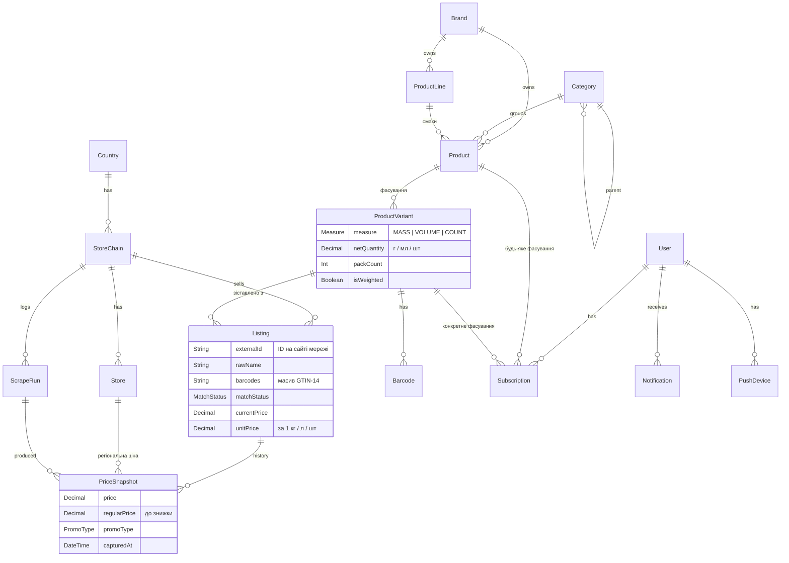

# База даних OnniMart

Схема: [`apps/api/prisma/schema.prisma`](../apps/api/prisma/schema.prisma). Міграція: `apps/api/prisma/migrations/20261011120000_init`. Початкові дані: [`apps/api/prisma/seed.ts`](../apps/api/prisma/seed.ts).

## Що було не так у першій версії

| Проблема | Наслідок | Як виправлено |
|---|---|---|
| Варіації «смак» (Classic / Zero) і «фасування» (0,5 / 1 / 2 л) змішані: смак лежав у `Product.type` (рядок), фасування — у `ProductVariant` | Не можна підписатися на «Coca-Cola Zero будь-якого обʼєму» і не можна згрупувати смаки однієї лінійки | Три рівні: `ProductLine` → `Product` → `ProductVariant` |
| Кількість зберігалась як `value` + `units` (l / ml / kg / g) | `1 l` і `1000 ml` — різні рядки, унікальний індекс їх не ловить; ціну за кг рахувати незручно | `measure` (MASS / VOLUME / COUNT) + `netQuantity` у базових одиницях (г / мл / шт) + `packCount` для мультипаків |
| Один `barcode` на варіант | У реального товару штрихкодів кілька: у Red Bull на сторінці Сільпо їх 11 | Окрема таблиця `Barcode` (GTIN-14 — первинний ключ) |
| Немає історії цін, лише `Offer.price` | Немає «моніторингу» й аналізу — головної теми диплома | `PriceSnapshot` — запис з'являється лише при зміні ціни, акції чи наявності |
| `OfferRaw` без звʼязку з мережею, без часу збору й сирих даних; у міграції таблиця називалась `OfferRaw`, у схемі — `offers_raw` (drift) | Неможливо повторно зіставити товари чи відстежити джерело | `Listing` — картка товару мережі (сирі поля + `rawData` JSON + статус зіставлення) |
| `Offer` → `Store`, хоча сайти віддають ціни мережі | Для кожної мережі довелося б вигадувати «магазин» | `Listing` → `StoreChain`; `PriceSnapshot.storeId` — необовʼязкова регіональна ціна |
| `currency` nullable, у `Currencies` зайві JPY / GBP / CHF; у спільних типах інший регістр (`UAH`) | Неузгодженість | `Currency` (ISO 4217) на рівні країни й мережі |
| `Category` плоска, `Product.categoryId` і `description` обовʼязкові | Новий товар без категорії не створити | Дерево категорій (`parentId`); категорія та опис необовʼязкові |
| `tags` і `images` — `String?` | Списки в рядку | `attributes Json` (склад, КБЖВ…), `imageUrl`; теги — за потреби окремою таблицею |
| `Sale` — заглушка; підписок і сповіщень немає | Не покрито ключові функції | `PromoType` у `PriceSnapshot`, `Subscription`, `Notification`, `PushDevice` |
| `updatedAt @default(now())` замість `@updatedAt`, немає `createdAt` | Час оновлення не змінюється | Виправлено |

Ваші нотатки про повну картку товару (КБЖВ, алергени, добавки, умови зберігання тощо) не загубились. Вони лягають у `Product.attributes` (JSON), а заповнювати їх найпростіше з Open Food Facts за штрихкодом.

## ER-діаграма



## Як вимоги лягають на схему

| Вимога | Реалізація |
|---|---|
| Один товар з різних мереж — один запис у БД з різними цінами | `ProductVariant` (канонічний) ← кілька `Listing` (по одному на мережу) |
| Варіації смаку (Classic, Zero, Cherry) | `ProductLine` «Coca-Cola» → `Product` «Coca-Cola Zero» (`variantLabel = "Zero"`) |
| Варіації обʼєму (0,5 / 1 / 2 л) | `ProductVariant` з `netQuantity` 500 / 1000 / 2000 |
| Ціна за 1 кг / 1 л | `unitPrice = price / netQuantity × 1000`; для вагових товарів ціна вже за кг (`isWeighted`) |
| Підписка на знижку | `Subscription` на `Product` або `ProductVariant` + `targetPrice` / `notifyOnPromo` → `Notification` → Expo push |
| Сканування штрихкоду | `Barcode.gtin` (PK) → варіант → усі `Listing` з поточними цінами; якщо коду немає — Open Food Facts |
| Моніторинг та аналіз цін | `PriceSnapshot` (історія), `ScrapeRun` (журнал збору) |

## Потік даних

```
Rust-парсер ──JSON──▶ Redis "scraper:results" ──▶ IngestionWorker ──▶ IngestionService
                                                                           │
          ┌────────────────────────────────────────────────────────────────┘
          ▼
   1. parseQuantity(назва)  → measure / netQuantity / packCount / isWeighted
   2. normalizeBarcodes()   → лише валідні глобальні GTIN-14
   3. upsert Listing (chainId, externalId)
   4. PriceSnapshot, якщо змінилась ціна / знижка / наявність
   5. зіставлення за штрихкодом → Listing.variantId (AUTO_MATCHED, BARCODE)
```

Код: [`ingestion.service.ts`](../apps/api/src/modules/scraper/services/ingestion.service.ts), [`quantity.ts`](../apps/api/src/modules/catalog/normalization/quantity.ts), [`gtin.ts`](../apps/api/src/modules/catalog/normalization/gtin.ts).

## Зіставлення товарів (головна наукова частина)

Зіставлення йде трьома етапами. Кожен наступний етап обробляє лише те, що не вдалося попередньому.

### Етап 1. Точний збіг штрихкоду (реалізовано)

Сільпо та вітрини zakaz.ua віддають EAN. Перед порівнянням коди нормалізуються:

- перевіряється контрольна цифра;
- код доповнюється нулями до GTIN-14: `4820…` і `04820…` — це один і той самий товар;
- відкидаються коди «обмеженого обігу» (префікси 02x, 04x, 2xx). Мережі друкують їх самі для вагових товарів і внутрішніх артикулів, тому в іншій мережі той самий код означає інший товар. Приклад: серед 11 кодів Red Bull у Сільпо 6 — саме такі внутрішні (префікс 025), 5 інших — глобальні EAN-8, EAN-13 і GTIN-14.

Збіг дає `matchStatus = AUTO_MATCHED`, `matchMethod = BARCODE`, `matchScore = 1`.

### Етап 2. Нечітке зіставлення (наступний крок)

Потрібен для мереж без штрихкодів: АТБ, Lidl, ALDI.

1. **Нормалізація назви**:
   - нижній регістр;
   - прибрати службові слова («напій», «ПЕТ», «з/б», «м/уп», «д/п»);
   - уніфікувати «ё/е», «ß/ss», «ä/ae»;
   - витягнути бренд за словником `Brand`;
   - витягнути ознаки смаку: zero, light, cherry, «без цукру», «лимон».
2. **Блокування кандидатів** (щоб не порівнювати все з усім): той самий `measure`, `netQuantity` в межах ±2 %, той самий бренд або спільна категорія.
3. **Оцінка схожості**: зважена сума трьох складових:
   - триграмна схожість назв — `pg_trgm similarity()` у PostgreSQL;
   - Jaccard за токенами;
   - збіг ознак смаку. Протилежні ознаки, наприклад «zero» проти «original», — жорстке «ні».
4. **Пороги**:
   - ≥ 0,90 — `AUTO_MATCHED` (FUZZY);
   - 0,70–0,90 — `PENDING`, потрапляє в чергу модерації;
   - < 0,70 — створюється новий `Product` / `ProductVariant` з цієї картки.

### Етап 3. Модерація (наступний крок)

Адмін-сторінка зі списком `PENDING` і запропонованими кандидатами. Рішення модератора зберігаються як `CONFIRMED` / `REJECTED`. Це водночас розмічена вибірка для оцінки якості.

### Оцінка якості для диплома

Розмітити вручну 300–500 пар «картка ↔ варіант» з різних мереж і порахувати **precision / recall / F1** окремо для етапів 1 і 2 та для різних порогів. Таблиця з результатами — готовий експериментальний розділ.

## Історія цін: чому «запис лише при зміні»

Парсер обходить кожну мережу щонайменше раз на добу. Якщо записувати кожне спостереження, 20 000 товарів × 5 мереж × 365 днів ≈ 36 млн рядків на рік, і майже всі вони — дублікати. Тому `PriceSnapshot` додається лише при зміні ціни, знижки чи наявності, а факт «товар ще продається» фіксує `Listing.lastSeenAt`. Ціна на будь-яку дату — це останній знімок до цієї дати. Графік будується як ступінчаста функція.

Для швидких запитів поточний стан денормалізовано в `Listing` (`currentPrice`, `unitPrice`, `isOnPromo`). Індекс `(listingId, capturedAt DESC)` обслуговує графіки.

## Що додати пізніше

- `CREATE EXTENSION pg_trgm` + GIN-індекс на `listings.rawName` — для етапу 2.
- Meilisearch-індекс `products` (назва, бренд, штрихкоди, мінімальна ціна) — для пошуку з урахуванням друкарських помилок.
- Мапінг категорій мереж на канонічні (`ChainCategory`).
- Партиціювання `price_snapshots` за місяцями або TimescaleDB — лише якщо даних справді стане багато.
- Перерахунок валют (UAH ↔ EUR) для порівняння України й Німеччини — таблиця курсів НБУ.
