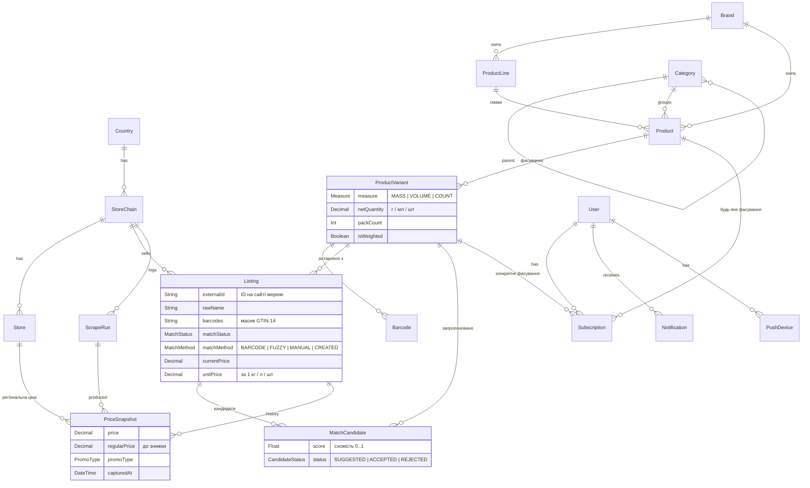

# База даних OnniMart

Схема: [`apps/api/prisma/schema.prisma`](../apps/api/prisma/schema.prisma). Міграція: `apps/api/prisma/migrations/20261011120000_init`. Початкові дані: [`apps/api/prisma/seed.ts`](../apps/api/prisma/seed.ts).

## Що було не так у першій версії

| Проблема | Наслідок | Як виправлено |
|---|---|---|
| Варіації «смак» (Classic / Zero) і «фасування» (0,5 / 1 / 2 л) змішані: смак лежав у `Product.type` (рядок), фасування — у `ProductVariant` | Не можна підписатися на «Coca-Cola Zero будь-якого обʼєму» і не можна згрупувати смаки однієї лінійки | Три рівні: `ProductLine` → `Product` → `ProductVariant` |
| Кількість зберігалась як `value` + `units` (l / ml / kg / g) | `1 l` і `1000 ml` — різні рядки, унікальний індекс їх не ловить; ціну за кг рахувати незручно | `measure` (MASS / VOLUME / COUNT) + `netQuantity` у базових одиницях (г / мл / шт) + `packCount` для мультипаків |
| Один `barcode` на варіант | У реального товару штрихкодів кілька: у Red Bull на сторінці Сільпо їх 11 | Окрема таблиця `Barcode` (GTIN-14 — первинний ключ) |
| Немає історії цін, лише `Offer.price` | Немає «моніторингу» й аналізу — головної теми диплома | `PriceSnapshot` — запис з'являється лише при зміні ціни, акції чи наявності |
| `OfferRaw` без звʼязку з мережею, без часу збору й сирих даних; у міграції таблиця називалась `OfferRaw`, у схемі — `offers_raw` (drift) | Неможливо повторно зіставити товари чи відстежити джерело | `Listing` — картка товару мережі (сирі поля + `rawData` JSON + статус зіставлення) |
| `Offer` → `Store`, хоча сайти віддають ціни мережі | Для кожної мережі довелося б вигадувати «магазин» | `Listing` → `StoreChain`; `PriceSnapshot.storeId` — необовʼязкова регіональна ціна |
| `currency` nullable, у `Currencies` зайві JPY / GBP / CHF; у спільних типах інший регістр (`UAH`) | Неузгодженість | `Currency` (ISO 4217) на рівні країни й мережі |
| `Category` плоска, `Product.categoryId` і `description` обовʼязкові | Новий товар без категорії не створити | Дерево категорій (`parentId`); категорія та опис необовʼязкові |
| `tags` і `images` — `String?` | Списки в рядку | `attributes Json` (склад, КБЖВ…), `imageUrl`; теги — за потреби окремою таблицею |
| `Sale` — заглушка; підписок і сповіщень немає | Не покрито ключові функції | `PromoType` у `PriceSnapshot`, `Subscription`, `Notification`, `PushDevice` |
| `updatedAt @default(now())` замість `@updatedAt`, немає `createdAt` | Час оновлення не змінюється | Виправлено |

Ваші нотатки про повну картку товару (КБЖВ, алергени, добавки, умови зберігання тощо) не загубились. Вони лягають у `Product.attributes` (JSON), а заповнювати їх найпростіше з Open Food Facts за штрихкодом.

## ER-діаграма



## Як вимоги лягають на схему

| Вимога | Реалізація |
|---|---|
| Один товар з різних мереж — один запис у БД з різними цінами | `ProductVariant` (канонічний) ← кілька `Listing` (по одному на мережу) |
| Варіації смаку (Classic, Zero, Cherry) | `ProductLine` «Coca-Cola» → `Product` «Coca-Cola Zero» (`variantLabel = "Zero"`) |
| Варіації обʼєму (0,5 / 1 / 2 л) | `ProductVariant` з `netQuantity` 500 / 1000 / 2000 |
| Ціна за 1 кг / 1 л | `unitPrice = price / netQuantity × 1000`; для вагових товарів ціна вже за кг (`isWeighted`) |
| Підписка на знижку | `Subscription` на `Product` або `ProductVariant` + `targetPrice` / `notifyOnPromo` → `Notification` → Expo push |
| Сканування штрихкоду | `Barcode.gtin` (PK) → варіант → усі `Listing` з поточними цінами; якщо коду немає — Open Food Facts |
| Моніторинг та аналіз цін | `PriceSnapshot` (історія), `ScrapeRun` (журнал збору) |

## Потік даних

```
Rust-парсер ──JSON──▶ Redis "scraper:results" ──▶ воркер: IngestionWorker ──▶ IngestionService
                                                                           │
          ┌────────────────────────────────────────────────────────────────┘
          ▼
   1. parseQuantity(назва)  → measure / netQuantity / packCount / isWeighted
   2. normalizeBarcodes()   → лише валідні глобальні GTIN-14
   3. upsert Listing (chainId, externalId)
   4. PriceSnapshot, якщо змінилась ціна / знижка / наявність
   5. зіставлення за штрихкодом → Listing.variantId (AUTO_MATCHED, BARCODE)
```

Код: [`ingestion.service.ts`](../apps/api/src/modules/scraper/services/ingestion.service.ts), [`quantity.ts`](../packages/matching/src/normalization/quantity.ts), [`gtin.ts`](../packages/matching/src/normalization/gtin.ts).

## Зіставлення товарів (головна наукова частина)

Зіставлення йде трьома етапами. Кожен наступний етап обробляє лише те, що не вдалося попередньому.

### Етап 1. Точний збіг штрихкоду (реалізовано)

Сільпо та вітрини zakaz.ua віддають EAN. Перед порівнянням коди нормалізуються:

- перевіряється контрольна цифра;
- код доповнюється нулями до GTIN-14: `4820…` і `04820…` — це один і той самий товар;
- відкидаються коди «обмеженого обігу» (префікси 02x, 04x, 2xx). Мережі друкують їх самі для вагових товарів і внутрішніх артикулів, тому в іншій мережі той самий код означає інший товар. Приклад: серед 11 кодів Red Bull у Сільпо 6 — саме такі внутрішні (префікс 025), 5 інших — глобальні EAN-8, EAN-13 і GTIN-14.

Збіг дає `matchStatus = AUTO_MATCHED`, `matchMethod = BARCODE`, `matchScore = 1`.

### Етап 2. Нечітке зіставлення (реалізовано)

Потрібен для мереж без штрихкодів: Сільпо, VARUS, ALDI, PENNY, NORMA. Код — [`packages/matching`](../packages/matching/src) (бібліотека без залежностей від БД; запис у БД — [`matching.service.ts`](../apps/api/src/modules/catalog/matching/matching.service.ts) у воркері).

1. **Нормалізація назви** ([`features.ts`](../packages/matching/src/features.ts)):
   - нижній регістр, `ß → ss`, без діакритики й апострофів, латинські літери в кириличних словах («дiтей» з латинською i) замінюються кириличними;
   - прибирається фасування («0,5л», «6х0,33 л», «1,5-L-Flasche») і службові слова («напій», «ПЕТ», «Flasche», «versch. Sorten»);
   - прибираються слова бренду; якщо мережа бренд не вказала, він шукається в назві за словником брендів тієї ж країни (ALDI Nord «Coca-Cola» без бренду → `coca-cola`);
   - «без глютену», «ohne Gentechnik» лишаються одним словом.
2. **Ознаки різновиду** — окремо від слів назви:
   - `sugar` (Zero / «без цукру» / zuckerfrei, Light), `caffeine`, `lactose` («безлактозне», laktosefrei), `organic` (Bio, «органічний», а також бренд «GUT BIO») — **сувора** група: якщо ознака є лише з одного боку, це інший товар (Coca-Cola ≠ Coca-Cola Zero);
   - `gas` (негазована / слабо- / сильногазована), відсоток жирності чи міцності, кількість штук («60л 20шт» ≠ «60л 40шт») — конфлікт лише якщо обидва значення відомі й різні.
3. **Блокування кандидатів**: те саме розпізнане фасування (міра, кількість, мультипак, ваговий) і хоча б одне спільне слово (за першими 4 літерами).
4. **Оцінка схожості** ([`similarity.ts`](../packages/matching/src/similarity.ts)):
   - слова зважуються за IDF окремо для кожної країни — рідкісне «слива» важить більше за часте «молоко»;
   - слова порівнюються нечітко: різні закінчення («мінеральна» / «мінеральний») — 0,9, описки (біграмний коефіцієнт Дайса ≥ 0,8);
   - схожість назв = середнє зваженого коефіцієнта Жаккара і коефіцієнта включення;
   - множник бренду: той самий — 1; суббренд — 0,8; відомий лише з одного боку — 0,85; різні — 0.
5. **Рішення** ([`catalog-index.ts`](../packages/matching/src/catalog-index.ts)):
   - ≥ 0,90 і відрив від другого кандидата ≥ 0,05 — `AUTO_MATCHED` (FUZZY);
   - 0,70–0,90, нічия або різні штрихкоди при неповному збігу назви — `MatchCandidate`, черга модерації;
   - нижче — той самий бренд і назва іншого фасування → нове `ProductVariant` наявного товару, інакше новий `Product` (`matchMethod = CREATED`).
   - Жорсткі «ні»: картка тієї ж мережі (у мережі це інший товар), пара, яку модератор відхилив.
   - **Інша країна.** Спершу розглядаються фасування, що вже продаються в країні картки. Товар іншої країни приєднується лише за повного збігу бренду, нормалізованої назви й фасування (схожість ≥ 0,99) і без модерації: назви різними мовами дають випадкові часткові збіги. Так «Напій газований Coca-Cola 1,25л» (ЕКО, NOVUS…) і «Cola Original 1,25 l» (ALDI SÜD) стають одним фасуванням з цінами в ₴ і €, а «Cola Light» чи «Cola Mix» — ні. На сторінці товару ціни згруповано за валютою.

Нові товари групуються в лінійки: бренд + перші два слова назви без смаків («Яготинське для дітей · паста сиркова» → банан, персик, малина…). `Product.variantLabel` — ознаки й смаки («без цукру · 2,2%»).

Зіставлення запускається пакетно після кожного запуску парсера (`run_finished`) і кнопкою в адмінці (`POST /api/v1/matching/run`). Спершу обробляються картки зі штрихкодами — вони стають «якорями» для решти. Повний прохід 10 тис. карток триває ~2,5 хв.

**Інкрементальне зіставлення.** Каталог — постійна база: щоденний обхід лише оновлює ціни наявних карток і додає нові. Щоб пакет не перечитував увесь каталог, для кожного фасування в таблиці `match_keys` зберігаються ключі пошуку — ті самі блоки, якими `CatalogIndex` відбирає кандидатів: «фасування + перші 4 літери слова» (`VOLUME:1500:1|морш`) з назви товару й кожної зіставленої картки, а також бренд (`b:morshynska`). Пакет завантажує лише нові картки й фасування, з якими в них є спільний ключ або штрихкод; словник брендів і IDF кешуються у воркері на годину. Значущі слова кожної картки рахуються один раз (`listings.nameTokens`, перерахунок — коли змінилась назва, бренд або словник брендів), а частоти слів по країнах для IDF рахує PostgreSQL одним `GROUP BY` — у памʼять воркера потрапляє лише словник, а не всі назви. На копії бази всі 9 458 ваг слів і 300/300 рішень зіставлення збіглися з підрахунком у памʼяті; оновлення словника — 0,15 с. Перевірка на копії бази (10 157 карток, 9 239 фасувань): для 500 і 100 «нових» карток рішення інкрементального режиму збіглися з рішеннями на повністю завантаженому каталозі в 100 % випадків; завантаження індексу для пакета зі 100 карток — 0,55 с проти 1,59 с і, на відміну від повного режиму, не зростає з розміром каталогу.

### Етап 3. Модерація (реалізовано)

Сторінка `/matching` адмінки показує картки з кандидатами (`MatchCandidate.status = SUGGESTED`): назву, ціни мереж, схожість. Модератор:

- **підтверджує** кандидата → `CONFIRMED` / `MANUAL`, штрихкоди картки додаються до фасування;
- **відхиляє всіх** → пари стають `REJECTED` і більше не пропонуються, картка стає окремим товаром;
- **відвʼязує** помилково зіставлену картку на сторінці товару → пара `REJECTED`, картка зіставляється заново.

Рішення зберігаються — це водночас розмічена вибірка для оцінки якості.

### Оцінка якості (експеримент для диплома)

Скрипт [`scripts/evaluate-matching.ts`](../apps/api/scripts/evaluate-matching.ts) (`bun run match:evaluate`) використовує штрихкоди як еталон: картки різних мереж зі спільним GTIN — точно той самий товар. Алгоритм проганяється на цих картках зі **схованими** штрихкодами, рахуються попарні precision / recall (стандартні метрики entity resolution).

Результат на даних 12.10.2026 (14 мереж, 10 157 карток, з них 4 283 зі штрихкодом, 409 еталонних пар, одна з них — між країнами):

| Поріг авто | Об’єднано пар | Правильних | Precision | Recall | F1 |
|---|---|---|---|---|---|
| 0,80 | 470 | 397 | 84,5 % | 97,1 % | 0,903 |
| 0,90 | 466 | 398 | 85,4 % | 97,3 % | 0,910 |
| 0,95 | 464 | 398 | 85,8 % | 97,3 % | 0,912 |

**Еталон сам помиляється.** З 68 «хибних» пар при порозі 0,90 у 62 назви збігаються дослівно: «Олія Олейна Традиційна рафінована 850мл» у NOVUS має інший GTIN, ніж в Ашані й ЕКО; пиво Corona — імпортний і місцевий штрихкод. Ще 4 — той самий товар з опискою чи іншим порядком слів («Farfalle» / «Farfale»). Справжніх помилок дві: «Neo Demi Purple Yellow Boost» ↔ «Purple Boost» і «Frosch Зелений лимон» ↔ «Frosch Лимон». З поправкою на це **precision ≈ 99,5 %**.

Висновки, що вплинули на алгоритм:

- один товар часто має кілька GTIN, тож різні штрихкоди — не заборона, а привід віддати пару модератору (автоматично — лише за повного збігу нормалізованої назви);
- «1,5л 6шт» у METRO — упаковка з 6 пляшок, а не одна пляшка: розбір фасування виправлено, збережені картки перераховано з `rawData` (`bun run listings:reparse`);
- бренд, відомий лише з одного боку, давав помилки на власній кухні мереж («Котлета Домашня» NOVUS ↔ МегаМаркет), тому такі пари йдуть лише на модерацію.

Для мереж без штрихкодів (Сільпо, VARUS, ALDI) точність оцінювалася вибірково вручну; повну розмітку дадуть рішення модератора.

## Історія цін: чому «запис лише при зміні»

Парсер обходить кожну мережу щонайменше раз на добу. Якщо записувати кожне спостереження, 20 000 товарів × 5 мереж × 365 днів ≈ 36 млн рядків на рік, і майже всі вони — дублікати. Тому `PriceSnapshot` додається лише при зміні ціни, знижки чи наявності, а факт «товар ще продається» фіксує `Listing.lastSeenAt`. Ціна на будь-яку дату — це останній знімок до цієї дати. Графік будується як ступінчаста функція.

Для швидких запитів поточний стан денормалізовано в `Listing` (`currentPrice`, `unitPrice`, `isOnPromo`). Індекс `(listingId, capturedAt DESC)` обслуговує графіки.

## Що додати пізніше

- `pg_trgm` у PostgreSQL не знадобився: схожість рахується в памʼяті з блокуванням кандидатів (10 тис. карток — ~2,5 хв). Якщо карток стане сотні тисяч, блоки можна відбирати SQL-запитом з GIN-індексом.
- Meilisearch-індекс `products` (назва, бренд, штрихкоди, мінімальна ціна) — для пошуку з урахуванням друкарських помилок.
- Мапінг категорій мереж на канонічні (`ChainCategory`).
- Партиціювання `price_snapshots` за місяцями або TimescaleDB — лише якщо даних справді стане багато.
- Перерахунок валют (UAH ↔ EUR) для порівняння України й Німеччини — таблиця курсів НБУ.
