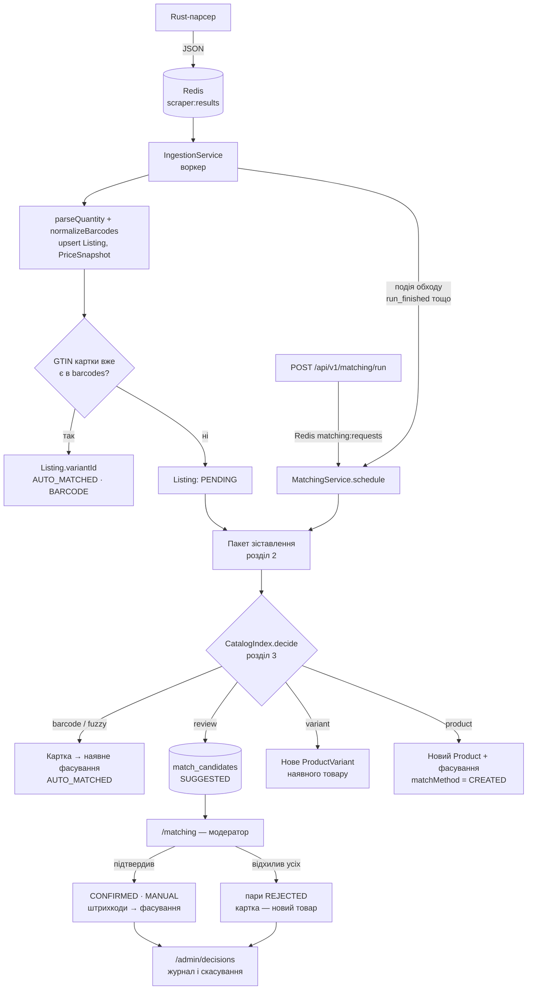
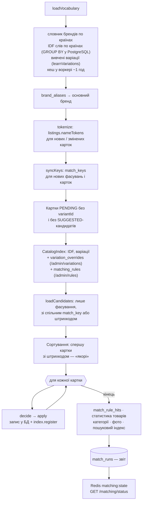
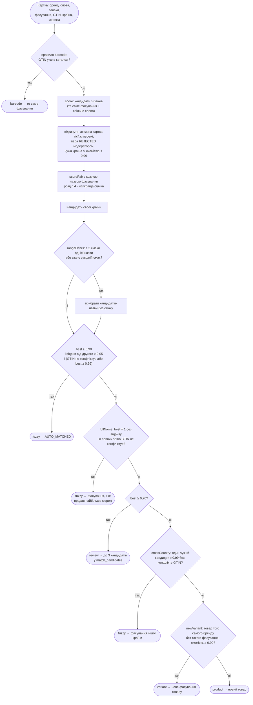
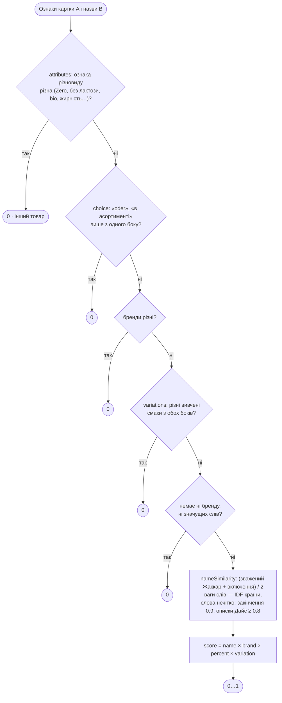
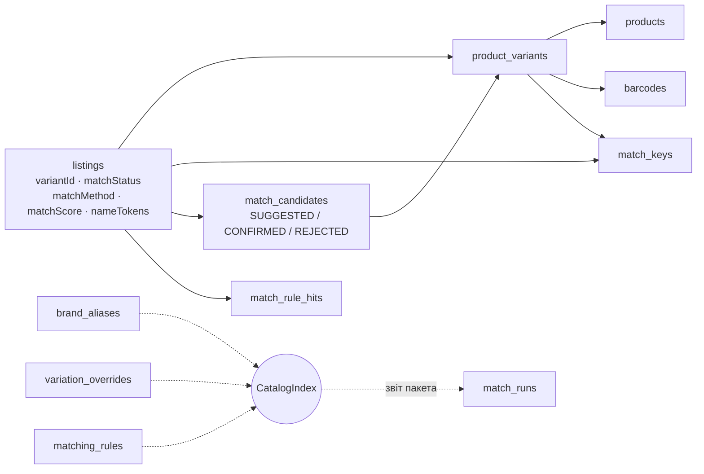

# Схема зіставлення товарів

Як картка мережі (`Listing`) стає частиною каталогу: товар (`Product`) → фасування (`ProductVariant`) → картки мереж з цінами. Текстовий опис алгоритму, пороги й оцінка якості — у [02-database.md](02-database.md#зіставлення-товарів-головна-наукова-частина), варіації — у [08-variations.md](08-variations.md). Тут — схеми того, як це працює в коді.

## 1. Загальний потік

Зіставлення за штрихкодом відбувається двічі: одразу при інжесті ([`ingestion.service.ts`](../apps/api/src/modules/scraper/services/ingestion.service.ts), `matchByBarcode`) — щоб нова ціна відомого товару зʼявилась без чекання пакета, — і першим кроком `decide` у пакеті, для штрихкодів, які зʼявились у каталозі вже після інжесту картки.

## 2. Пакет зіставлення у воркері

Код — `execute()` у [`matching.service.ts`](../apps/api/src/modules/catalog/matching/matching.service.ts). Пакет один на воркер: якщо під час роботи прийшов ще запит, наступний пакет запуститься одразу після поточного.

Після кожного рішення картка одразу додається в індекс (`register`): наступна картка пакета вже бачить фасування, створене попередньою. Тому дві нові картки того самого товару з різних мереж в одному пакеті зливаються, а не створюють два товари.

### Блокування кандидатів

Порівнювати кожну картку з усім каталогом надто дорого, тож кандидатів відбирають за ключами ([`catalog-index.ts`](../packages/matching/src/catalog-index.ts), ті самі ключі зберігаються в `match_keys`):

| Ключ | Приклад | Навіщо |
|---|---|---|
| фасування + перші 4 літери слова | `VOLUME:1500:1\|морш` | кандидати-фасування того самого розміру зі спільним словом |
| бренд | `b:morshynska` | товари бренду — для нового фасування |
| штрихкод | `04820…` (GTIN-14) | прямий збіг |

## 3. Рішення для однієї картки — `CatalogIndex.decide`

Кожне рішення несе список правил, що на нього вплинули (`decision.rules`), — вони пишуться в `match_rule_hits` і показуються на `/admin/rules`.

## 4. Оцінка пари назв — `scorePair`

Код — [`similarity.ts`](../packages/matching/src/similarity.ts). Ознаки назви (бренд, значущі слова, ознаки різновиду) готує [`features.ts`](../packages/matching/src/features.ts).

| Множник | Значення |
|---|---|
| `brand` | той самий — 1; суббренд — 0,8; відомий лише з одного боку — 0,85 |
| `percent` | жирність / міцність вказана лише з одного боку — 0,9 |
| `variation` | вивчена варіація лише з одного боку — 0,85 |

## 5. Що зберігається

| `matchStatus` · `matchMethod` | Рішення |
|---|---|
| `PENDING` | нова картка, ще не зіставлена; або чекає модератора (`review`), або її відвʼязали |
| `AUTO_MATCHED` · `BARCODE` | `barcode` (при інжесті або в пакеті) |
| `AUTO_MATCHED` · `FUZZY` | `fuzzy`, зокрема товар іншої країни |
| `AUTO_MATCHED` · `CREATED` | `variant` або `product`: картка стала основою нового фасування чи товару |
| `CONFIRMED` · `MANUAL` | модератор підтвердив кандидата |
